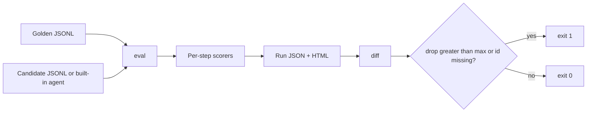

# trajectory-eval-harness

Grades an agent trajectory one step at a time: the tool, the arguments, the observation, and the final answer. A final-answer check is one scorer among several. Golden trajectories are JSONL. A gate fails a run when the suite mean drops past a threshold.

## What it is
- `trajeval/score.py` — index-aligned scorers: exact match, a JSON Schema subset, tool choice, final answer, and a judge hook. Default weights are in that file.
- `trajeval/judge.py` — `MockJudge`, a deterministic lexical stand-in. It builds the prompt a model judge would be sent and does not call one. `FunctionJudge` is the hook.
- `trajeval/gate.py` — compares two run files. Exit code 1 when the mean drops past `--max-drop`, or when a baseline id is missing.
- `trajeval/catalog.py` — 10 task families. `generate` expands them to the golden file.
- `trajeval/agents.py` — `sample` follows the reference policy. `regressed` edits that trace in a fixed way.
- `bench/run_eval.py` — writes the numbers below.

## Why
A trajectory can call the wrong tool and still end on the right sentence, or it can call the right tools and then answer "unable to complete." Scoring only the last string misses the first failure and scoring only the tool calls misses the second. This harness keeps both, and it keeps a diff so a later run can be rejected when it gets worse.

## Architecture


## How it works
Steps are compared by index. An extra call inserted at the front is not shifted back into alignment. Argument equality is canonical JSON, so key order does not matter. Schemas check shape. A wrong city still passes `"type": "string"`.

| Scorer | Weight | A score of 1 |
|---|---|---|
| `tool_choice` | 0.25 | Same tool name at that index. A missing or extra step is 0. |
| `exact` | 0.30 | Mean of tool name, arguments, and observation. The tool name is also in `tool_choice`; a wrong tool is meant to be expensive. |
| `schema` | 0.15 | Arguments and observation match the golden step's schema. Extra steps are not in this average. |
| `final_answer` | 0.20 | Exact after case-fold and whitespace collapse, otherwise token F1. |
| `judge` | 0.10 | `0.7 * mean(step judge) + 0.3 * answer judge`. The mock step score is `0.5 * tool + 0.3 * argument-key Jaccard + 0.2 * observation-key Jaccard`. |

If a golden step has no schema, that weight is redistributed. Scores are rounded to 6 decimal places. The gate recomputes the mean from per-trajectory scores. A `mean` field that disagrees with those rows is a warning and does not decide the result. Format details: [docs/TRAJECTORY_FORMAT.md](docs/TRAJECTORY_FORMAT.md). `data/example.jsonl` is the first record of the golden file.

## Results
### Sample agent against the golden file — SYNTHETIC
Run: `python3 bench/run_eval.py`. Raw output: [`results/measurements.json`](results/measurements.json), [`results/baseline.json`](results/baseline.json), [`results/regressed.json`](results/regressed.json). HTML: [`results/sample-report.html`](results/sample-report.html), [`results/regressed-report.html`](results/regressed-report.html), [`results/diff-report.html`](results/diff-report.html).

132 trajectories expanded from 10 families (weather, file, calculate, search, calendar, inventory, convert, ticket, order, fx). Every record is `source: "synthetic"`. The world is a fixture: temperatures, stock counts, and currency rates are values chosen so the arithmetic is exact, not quotes from a live system. The judge is the mock. No model was called.

The sample agent is the reference policy. It scores 1.0000 on every trajectory. The regressed agent runs that policy and then edits the recorded trace. The edit is chosen by `crc32(id) % 7` over `ok, ok, ok, wrong_tool, drop_arg, bad_answer, drop_step`. That hash is not a uniform split of these ids; the counts below are the measured ones. `wrong_tool`, `drop_arg`, and `drop_step` leave the final answer untouched. `bad_answer` leaves the steps untouched and replaces the answer with "Unable to complete the request."

| Agent | Suite mean | Gate at max drop 0.01 |
|---|---|---|
| sample | 1.0000 | pass |
| regressed | 0.7041 | fail, drop 0.2959 |

```
suite mean 1.0000 -> 1.0000 (drop 0.0000, max 0.0100)
suite mean 1.0000 -> 0.7041 (drop 0.2959, max 0.0100)
```

Regressed run, by scorer. The final-answer column is what a last-string grader would have reported. It stays at 0.8510 while the suite mean is 0.7041, because three of the four edits do not touch the answer.

| scorer | mean |
|---|---|
| tool_choice | 0.7500 |
| exact | 0.6263 |
| schema | 0.5739 |
| final_answer | 0.8510 |
| judge | 0.7246 |

By injected edit:

| fault | n | mean | tool_choice | exact | schema | final_answer | judge |
|---|---|---|---|---|---|---|---|
| ok | 49 | 1.0000 | 1.0000 | 1.0000 | 1.0000 | 1.0000 | 1.0000 |
| wrong_tool | 18 | 0.3503 | 0.1389 | 0.1389 | 0.2083 | 1.0000 | 0.4264 |
| drop_arg | 27 | 0.6532 | 1.0000 | 0.3951 | 0.0926 | 1.0000 | 0.7083 |
| bad_answer | 20 | 0.7738 | 1.0000 | 1.0000 | 1.0000 | 0.0167 | 0.7050 |
| drop_step | 18 | 0.2514 | 0.0278 | 0.0278 | 0.0278 | 1.0000 | 0.3194 |

What it shows:
- `wrong_tool` and `drop_step` keep a final-answer score of 1.0000 and still land at 0.3503 and 0.2514.
- `drop_step` tool choice is 0.0278 because 17 of those 18 tasks have one step, so deleting the last step deletes the only call (score 0). The other one, `ticket-010`, keeps the classify step and loses the assign step (score 0.5). 0.5 / 18 = 0.0278. Exact and schema move the same way on this fault.
- `drop_arg` keeps the tool name (tool choice 1.0000) and the final answer (1.0000). Schema is 0.0926: 22 of the 27 lose the only step's required argument and score 0, and five two-step tasks (`search-005`, `search-007`, `ticket-000`, `ticket-001`, `ticket-004`) fail the edited step and keep the second step, scoring 0.5. 5 × 0.5 / 27 = 0.0926.
- `bad_answer` is the other direction: tool choice, exact, and schema stay at 1.0000, and the answer mean is 0.0167. Eighteen of the twenty share no tokens with "Unable to complete the request." `search-003` shares "the" and `ticket-011` shares "to", and each scores 0.166667. 2 × 0.166667 / 20 = 0.016667, which displays as 0.0167. That is an overlapping word, not a partially correct answer. A step-only grader would have scored all twenty of these 1.
- `wrong_tool` schema is 0.2083, not 0. Five of the 18 are `search-*` tasks. The corrupted call is still a string under the key `query`, so the argument schema passes and the observation schema fails (0.5 on that step) while the untouched `open_page` step scores 1, and the trajectory schema is 0.75. The other 13 score 0. (5 × 0.75) / 18 = 0.2083. Tool choice on the same five is 0.5, and 0 on the rest: (5 × 0.5) / 18 = 0.1389. Schema does not look at the tool name.

These are measurements of two scripted agents on a synthetic set. They are not a score for any production agent.

## Tests
The suite covers the JSONL reader, the schema subset (including boolean-is-not-an-integer), each scorer, index alignment, the mock judge and a custom hook, gate thresholds (equal to the threshold passes, past it fails, a lied `mean` field is ignored, a missing id fails under a wide threshold), the golden file matching `generate(0)`, seed changing wording only, and the CLI exit code when the regressed agent is gated.

```
$ python3 -m pytest -q
............................................................             [100%]
60 passed
```

## Run it
```bash
pip install -r requirements.txt
python3 -m pytest -q
python3 bench/run_eval.py
python3 -m trajeval eval --golden data/golden.jsonl --agent sample --out results/baseline.json --html results/sample-report.html
python3 -m trajeval gate --baseline results/baseline.json --current results/baseline.json --max-drop 0.01
```

To score your own traces, write a JSONL file in the same shape and pass `--candidate` instead of `--agent`.

## CI gate
[`.github/workflows/eval-gate.yml`](.github/workflows/eval-gate.yml) runs [`scripts/ci.sh`](scripts/ci.sh) on pull requests and on pushes to `main`. The script tests, scores the sample agent, and runs the gate against `results/baseline.json` with `--max-drop 0.01`. A drop greater than 0.01 fails the job. The same script then scores the regressed agent and fails the job if that gate returns success, so a gate weakened to always pass is also a red build.

The gate compares a fresh run to the committed baseline. Updating the agent and the baseline in the same PR makes the gate pass. Review baseline diffs.

## Limits
- Index alignment only. A correct step moved by one position fails the later steps. There is no edit-distance alignment.
- `exact` and `tool_choice` both count the tool name. The weights are not five independent measurements.
- Schema is shape, not truth. The mock judge's Jaccard is over keys, not values. A wrong city with the right keys scores well on those two and badly on exact match.
- The mock judge is lexical. It is not a language model, and a fluent wrong answer with shared tokens scores above zero. `bad_answer` shows that.
- Thoughts are stored and not scored.
- The sample agent and the golden generator share the tool implementations. The committed golden file is the contract CI scores against. Regenerating the golden file to match a worse agent, and committing a new baseline, defeats the gate.
- Fault names are not written on the trace. The table recomputes them from the id. The harness never reads a fault label.
- All 132 trajectories are synthetic. Currency rates and page text are fixtures. Nothing here was fetched from a live API.
- No network calls. Wiring a real judge means passing a `FunctionJudge`. This repo does not ship a client.
- State is a file. There is no dataset version beyond the git blob of `data/golden.jsonl`.

## Stack
Python 3.12 · standard library · pytest

## License
MIT
